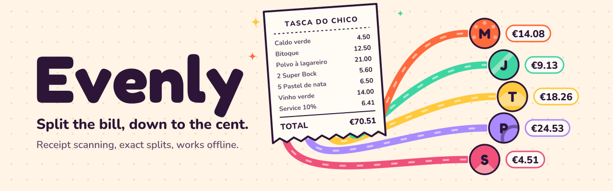
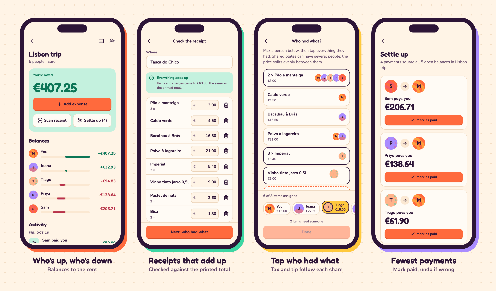
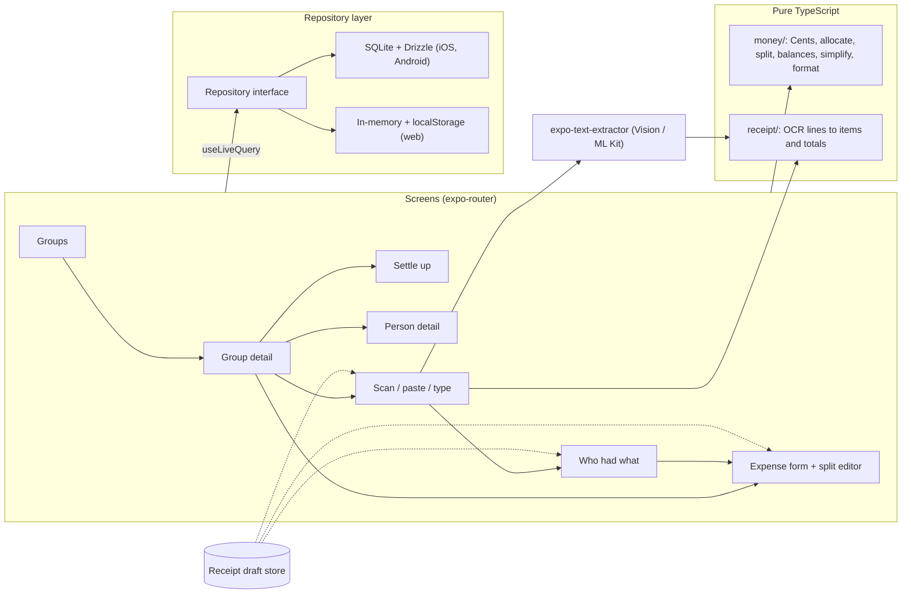

<picture>
  <source media="(prefers-color-scheme: dark)" srcset=".github/assets/banner-dark.svg">
  
</picture>

Evenly splits shared costs with friends down to the cent: photograph a receipt, tap who had what, and tax and tip follow each person's share, all on the phone and all offline.

[](https://github.com/emirk35/evenly/actions/workflows/ci.yml)
[](LICENSE)
[](https://docs.expo.dev/)
[](tsconfig.json)

<p align="center">
  
</p>

<p align="center">
  
</p>

## What it does

Splitting a dinner sounds like division until it isn't. Five people, one receipt, a shared bottle of wine, someone who only had soup, and a 10% service charge: dividing the total by five is unfair, and dividing each line by hand is where the extra cent goes missing. Evenly reads the receipt on the device, lets you hand out each line by tapping people's avatars, spreads tax, tip, and service in proportion to what each person actually had, and keeps a running balance per group. When the trip is over, it suggests the fewest practical payments to square everyone, and you mark them paid.

There is no account and no server. Groups, expenses, and payments live in SQLite on the phone, with stable ids and timestamps on every row so a sync layer can be added later without migrating identities.

## Quick start

Requirements: Node 22 or newer (CI runs the current LTS, 26) and pnpm 9.

```bash
pnpm install
EXPO_PUBLIC_DEMO_DATA=lisbon pnpm web    # http://localhost:4511 with the sample groups
pnpm test                                # money, receipt parser, repositories, components
```

Three ways to run it, from least to most setup:

| Target            | Command                                                                                            | Receipt photos                                            |
| ----------------- | -------------------------------------------------------------------------------------------------- | --------------------------------------------------------- |
| Browser           | `pnpm web` (port 4511)                                                                             | Paste text or type items; data persists in `localStorage` |
| Expo Go           | `pnpm start --go` (port 4510), scan the QR code                                                    | Paste text or type items; data in SQLite                  |
| Development build | `pnpm ios` or `pnpm android` (needs Xcode or Android Studio), or `eas build --profile development` | Camera and library, read on the device                    |

Photo recognition uses a native module, so it only exists in a development or store build. Expo Go and the web build say so on the scan screen and offer the paste and manual paths instead; nothing pretends to read a photo it cannot read. Leave `EXPO_PUBLIC_DEMO_DATA` unset to start from onboarding, or tap "Explore a sample Lisbon trip" there.

**Status of the native build.** All screens and flows were exercised on the web build. The iOS development build has not been run yet: with Xcode 26.3, `expo run:ios` stops inside Expo's own `expo-modules-jsi` 58.0.22 (a Swift 6 "sending 'slot' risks causing data races" error), before any app code compiles. The OCR adapter, the camera and library pickers, and the expo-sqlite startup path are wired up and type-checked (the same Drizzle migrations run against real SQLite through better-sqlite3 in the tests), but they have not been tried on a simulator or a phone.

## Architecture



Everything that touches money lives in `src/money` and `src/receipt`, two folders of pure TypeScript with no React, no I/O, and their own lint rules. Screens read through `useLiveQuery`, which runs a repository call and re-runs it after every write, so there is no client cache to invalidate. The repository is an interface with two implementations that pass one shared contract suite: SQLite through Drizzle on phones, and a JSON-snapshot store on the web, where expo-sqlite would need cross-origin isolation headers a static host cannot be assumed to send. The only cross-screen state is a receipt draft (scan, then assign, then the expense form), and that is the one place Zustand earns its keep. More detail, the data model, and sequence diagrams are in [docs/architecture.md](docs/architecture.md).

## Deep dive: getting money right

### Integers, enforced

Every amount is an integer number of minor units (cents, pence, or whole yen), carried in a branded type:

```ts
declare const centsBrand: unique symbol;
export type Cents = number & { readonly [centsBrand]: true };

export function cents(value: number): Cents {
  if (!Number.isSafeInteger(value)) {
    throw new RangeError(`Money must be a safe integer number of minor units, got ${value}`);
  }
  return (value === 0 ? 0 : value) as Cents; // -0 would render as "-€0.00"
}
```

`price * 1.23` produces a `number`, which does not typecheck where `Cents` is expected, so a float can only enter through `cents()`, which throws on it. The type cannot stop someone from doing float math on a plain number before branding it, so ESLint covers the rest: inside `src/money` and `src/receipt`, decimal literals, the `/` operator, `Math.round`/`floor`/`ceil`/`trunc`, `parseFloat`, and `toFixed` are errors. The single division in the module is BigInt division inside `allocate()`, behind a commented disable.

Parsing and formatting never build a fraction either. `parseDecimal("1.234,56", 2)` works on the string and returns `123456`. `formatMoney` passes only the whole-unit integer to `Intl.NumberFormat.formatToParts` and splices the minor digits back in from the integer's own decimal string, so the locale decides the symbol, grouping, and sign position while the digits on screen are exactly the digits in the database. The minor-unit exponent per currency (0 for JPY, 3 for KWD) is a hard-coded table rather than an `Intl` lookup, because two devices that disagree about it would disagree about every balance.

### Largest remainder allocation

Splitting €10.00 three ways has no exact answer, and the classic bug is rounding each share and losing or inventing a cent. `allocate(total, weights)` uses the largest remainder (Hamilton) method: every part starts at the floor of its exact quota, and the units lost to flooring go one at a time to the largest fractional remainders.

```ts
for (const weight of weights) {
  const [quotient, remainder] = divmod(magnitude * BigInt(weight), weightSum);
  parts.push(quotient);
  remainders.push(remainder);
}
let leftover = magnitude - parts.reduce((acc, part) => acc + part, 0n);
// sort indexes by remainder (desc), then by the caller's priority, and hand out `leftover` units
```

It runs in BigInt because `total * weight` passes 2^53 sooner than you would think (basis points times a large bill), and a float product there silently drops units; there is a test for exactly that case. fast-check checks the invariants on random inputs: parts always sum to the total, each part is the floor or ceiling of its exact quota, a zero weight gets nothing, a larger weight never gets less than a smaller one, and even splits differ by at most one unit.

**Who gets the leftover cent** is a policy decision, made in `leftoverPriority`: the payer absorbs it first (on €10.00 split three ways they cover €3.34, so the other two each owe €3.33 and nobody is chased for a cent they did not cause). Any further leftover units go to the other participants in an order rotated by a hash of the expense id. Rotation keeps one friend from eating the extra cent on every three-way split for a year; hashing instead of randomness means every device that recomputes the split gets the same answer. A test runs 3,000 seeded three-way splits and checks each person absorbs the extra cent more than 900 times.

### Five split modes, one engine

| Mode     | Input per person                                     | Becomes                         |
| -------- | ---------------------------------------------------- | ------------------------------- |
| Equal    | included or not                                      | `allocate(total, [1, 1, 0, 1])` |
| Shares   | integer weight (2 for someone who brought a partner) | `allocate(total, shares)`       |
| Percent  | basis points (33.33% is 3333), must total 10000      | `allocate(total, bps)`          |
| Exact    | minor units, must total the amount                   | used as is, mismatch reported   |
| Itemized | receipt lines assigned to people                     | two passes, below               |

Itemized splits allocate twice. First, each line is shared evenly by the people assigned to it. Then tax, tip, and fees minus any discount are pooled and allocated in proportion to each person's item subtotal, so whoever ordered the octopus carries the octopus's share of the service charge. Pooling before allocating keeps everyone within one unit of their exact proportional share; allocating tax and tip separately can put two rounding units on the same person. Every mode returns either shares that sum exactly to the total or a typed error (`exact-mismatch` with the remaining amount, `unassigned-items` with the item ids), which the form turns into a sentence next to the Save button: "€34.50 still to assign."

### Settling up with fewer payments

Net balances say who is up and who is down; turning them into payments is the interesting part. The true minimum number of payments is NP-hard: n people with non-zero balances need n − k payments, where k is the largest number of disjoint groups whose balances each sum to zero, and finding that partition is a subset-sum style search. `simplifyDebts` uses two cheap passes instead:

1. **Exact pairs.** A debtor who owes exactly what some creditor is owed pays them directly, settling two people with one payment.
2. **Largest first.** The person who owes the most pays the person owed the most, as much as possible. Every payment zeroes at least one of them, which is where the n − 1 bound comes from.

Property tests check that applying the payments zeroes every balance, nobody pays themselves, amounts are positive, debtors only send and creditors only receive (no one is asked to pass money along), there are at most n − 1 payments, and shuffling the input does not change the output. Ties break by person id so every device suggests the same payments.

To see how far this is from optimal, `simplify.optimality.test.ts` includes an exact solver (a bitmask DP over all 2^n subsets) as an oracle and compares on 400 seeded trip-shaped ledgers per group size, with expenses in round amounts split among random subsets, which is what makes zero-sum subgroups common:

| People         | 3   | 4   | 5   | 6   | 8   | 10  | 12  |
| -------------- | --- | --- | --- | --- | --- | --- | --- |
| Greedy optimal | 400 | 400 | 400 | 400 | 395 | 386 | 383 |

When it misses, it misses by exactly one payment (the test asserts that too). With the exact-pair pass disabled the counts drop to 399, 392, 385, and 379 for 6, 8, 10, and 12 people. Those counts come from `pnpm test simplify.optimality` (the counts are pinned in the test, so the run fails if the heuristic changes), plus one run with the pair pass commented out. The exact solver stays in the test because 2^n stops being cheap well before group sizes stop growing, and one extra payment in 4% of 12-person trips is a fair price for predictability.

### Reading receipts

`parseReceipt(lines, { currency })` is pure TypeScript and turns OCR lines into items (name, quantity, unit price, line total), subtotal, tax, tip, fees, discount, and total. OCR engines disagree about what a line is, so the first job is to rebuild rows:

- **Price tokens** need exactly the currency's decimals ("4,90", "$13.30", "3.00-"). That one rule keeps quantities, years, postcodes, and "0,5l" out of the price column. Zero-decimal currencies need a symbol or grouping instead ("¥980", "2,460").
- **Column reflow.** Apple Vision often returns a wide receipt as all the names, then all the prices. A run of m bare prices is zipped with the m text lines just above it, counting from the bottom so header lines are left alone; the same rule handles narrow printers that put each price on the next line. Bare integers above the names become a quantity column.
- **OCR repair** inside tokens: "1O.5O" is 10.50, "T0TAL" is TOTAL, "TAQUERlA" is TAQUERIA, but "0,5l" stays a half litre.
- **Classification** by keyword in English, Portuguese, Spanish, French, German, Italian, Dutch, and Japanese, in an order that matters: "TOTAL SAVINGS" is informational, "CHANGE DUE" is a payment, "Total tax" is tax, "Total incl. VAT" is the total. A tip suggestion block ("18% Tip $13.30 Total $87.17") is skipped.

Then it checks the arithmetic. Items plus charges must land on a printed total; if tax only balances when it is left out, the receipt is VAT-inclusive (normal in Europe) and the tax is shown but not added again. When several totals are printed (a pre-tip "Amount" and a final "Total"), the one the numbers support wins. The review screen shows the result as "Everything adds up" or "Off by €12.00", with a one-tap fix that adds the difference as its own line, so a missed row is visible instead of silently absorbed. Eleven fixtures in `src/receipt/__fixtures__` cover a San Francisco diner with tip suggestions, a Lisbon tasca with comma decimals and a VAT table, a Berlin beer garden with tax-class flags and bottle deposit, a London pub with a service charge and included VAT, Vision's column output, a narrow thermal printer, a US grocery receipt with weighed produce and card savings, a Tokyo ramen shop in yen, a noisy OCR scan, a receipt with a missed line, and a card slip with no items at all.

## Design decisions

- [ADR 0001](docs/adr/0001-integer-minor-units.md): integer minor units with a branded type and lint rules, not a decimal library.
- [ADR 0002](docs/adr/0002-largest-remainder-allocation.md): largest remainder allocation and the leftover-cent policy.
- [ADR 0003](docs/adr/0003-greedy-debt-simplification.md): greedy simplification with an exact-pair pass, measured against an exact oracle.
- [ADR 0004](docs/adr/0004-on-device-ocr-with-expo-text-extractor.md): expo-text-extractor for OCR, and why not ML Kit on iOS.
- [ADR 0005](docs/adr/0005-repository-layer-and-web-storage.md): a repository interface with SQLite on phones and a memory store on the web; Zustand only for the receipt draft.

The visual identity is warm and loud on purpose: tangerine actions on cream paper with deep plum ink, mint for money coming to you and berry for money you owe. Display type is Fredoka (rounded and chunky) and everything in lists is Nunito, whose default figures are tabular so amounts line up. Both are subset and bundled in `assets/fonts`. Primary buttons carry plum text because white on tangerine fails WCAG AA. Motion is springy but always tied to a change: an avatar chip arcs from the tray to the item it was just assigned to, balance bars grow from the center line, and a settled payment slides out. All of it is skipped when the OS asks for reduced motion.

## Testing

```bash
pnpm test            # all suites
pnpm test:coverage   # with coverage
pnpm lint && pnpm typecheck && pnpm format:check
```

Jest runs two projects. `domain` (Node environment) covers the money module, the receipt parser and fixtures, the expense editor's state logic, ledger selectors, the demo seed (whose Lisbon balances are pinned to the cent, because the screenshots show them), and a repository contract suite that runs against both the memory store and real SQLite (better-sqlite3 applying the same Drizzle migrations the app ships). `ui` (jest-expo, React Native Testing Library) renders the expense form and the item assignment board with a real in-memory repository and checks validation messages, disabled states, running totals, and what lands in storage. Reanimated is replaced by a small motion-off stand-in because its own Jest setup expects a DOM.

On an Apple M2 Pro, `time pnpm test:coverage` runs 221 tests in 16 suites in about 6 seconds. Coverage for `src/money` is 98.7% of statements and 90.5% of branches (99.6% of lines); `src/receipt` is 99.2% of statements and 97.1% of branches (100% of lines). Overall coverage is lower (74% of statements) because most screen components are exercised by hand on the web build rather than by tests.

## Project structure

```
src/
  app/                 expo-router screens (typed routes)
  money/               Cents, allocate, split, balances, simplify, parse, format
  receipt/             OCR line normalisation, classification, parser, fixtures
  data/                repository interface, SQLite (Drizzle) and memory implementations, seed
  features/            screen-level components: expense editor, receipt review and assignment,
                       ledger lists, settle-up cards
  ui/                  design tokens, type scale, buttons, avatars, illustrations, toasts
drizzle/               generated SQL migrations (bundled into the app)
docs/                  architecture notes and ADRs
```

## Roadmap

- **Sync.** Rows already carry client-generated UUIDs, `updated_at`, and soft-delete tombstones; the next step is a last-writer-wins merge per expense aggregate over a small relay, with invite links per group.
- **Multi-currency groups.** One currency per group keeps balances honest today. Trips across borders need per-expense currencies and an explicit, dated exchange rate.
- **Bounding boxes from OCR.** expo-text-extractor returns text without positions, so row reconstruction relies on order. A module that exposes line frames would make column reflow geometric instead of heuristic.
- **Recurring expenses** for rent and subscriptions in flat groups.

## License

[MIT](LICENSE)
