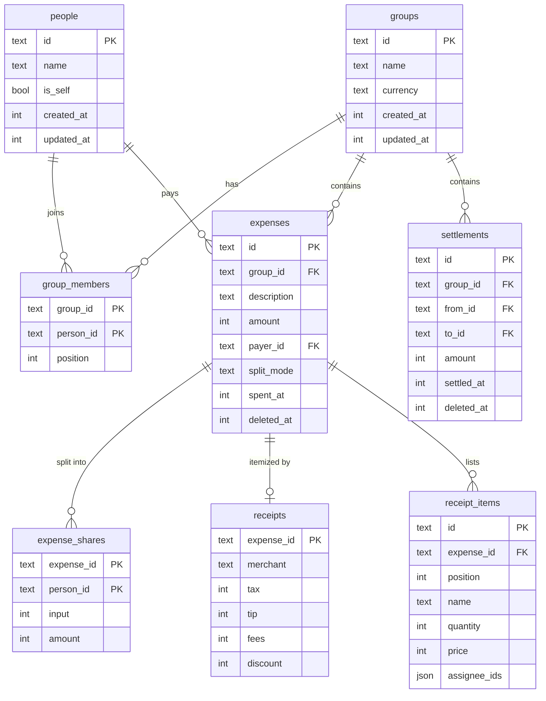
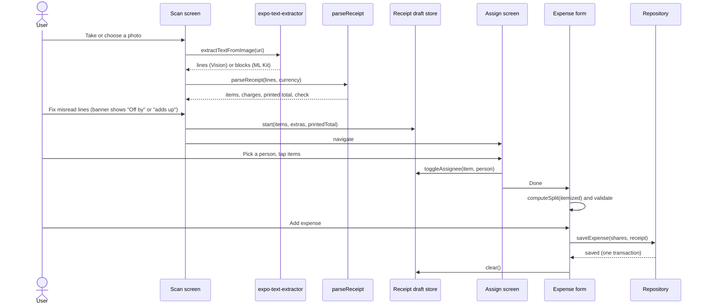
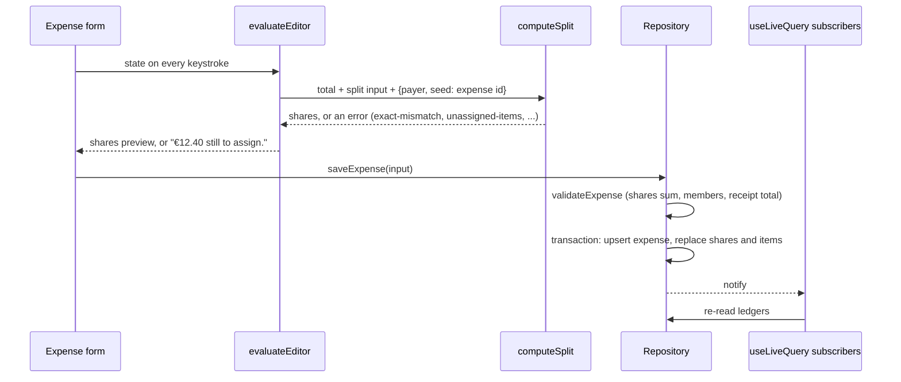
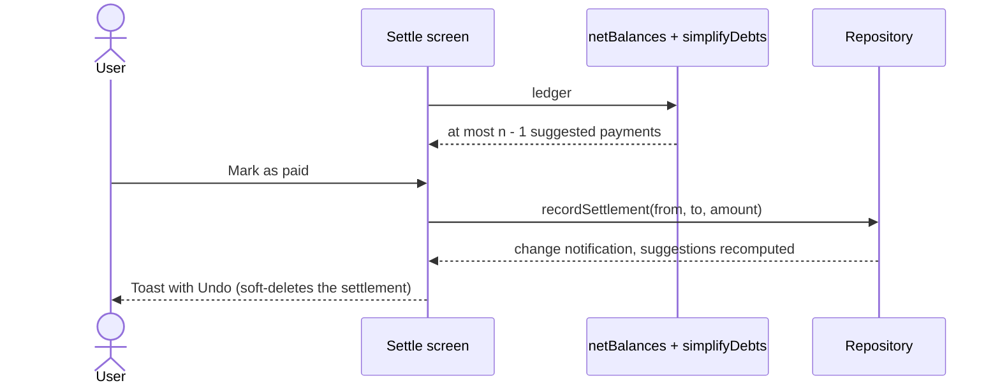

# Architecture

Evenly is an Expo app (SDK 58, React Native 0.88, New Architecture) with three layers: screens in `src/app` and `src/features`, a pure domain in `src/money` and `src/receipt`, and a repository layer in `src/data`. Dependencies point inward: screens call the domain and the repository; the domain imports nothing from React or storage.

## Layers

**Domain (`src/money`, `src/receipt`).** Plain TypeScript functions over integers. `allocate` is the only place money is divided. `computeSplit` turns a total plus a split description into shares or a typed error. `netBalances` and `personTotals` read a ledger; `simplifyDebts` turns balances into payments. `parseReceipt` turns OCR lines into a structured receipt with an arithmetic check. These modules have their own ESLint rules (no float literals, no `/`, no rounding calls) and the highest test coverage in the repo.

**Repository (`src/data`).** An async `Repository` interface with two implementations:

- `sqlite/repository.ts`: Drizzle ORM over a synchronous SQLite database. On phones that is expo-sqlite (`openDatabaseSync`, WAL, foreign keys on), migrated on launch with `useMigrations` and the SQL files in `drizzle/`. In tests it is better-sqlite3 with the same migration folder.
- `memory/repository.ts`: a JSON snapshot in memory. The web build restores it from `localStorage` at startup and writes it back after every change.

Both run `validate.ts` before writing and both pass `repository.contract.test.ts`. `useLiveQuery(load, key)` runs a read, subscribes to the repository, and re-runs the read after each write; screens never cache.

**Screens (`src/app`, `src/features`, `src/ui`).** expo-router with typed routes. Screen files are thin: they load a ledger and render a feature component. `src/ui` holds the design tokens (`theme.ts`), the type scale, and shared components (buttons with a press spring, generated avatars, money text with tabular figures, empty-state illustrations, toasts).

## Data model

Notes on the shape:

- **Money is INTEGER minor units** everywhere; the group's currency decides the exponent.
- **Shares store both the input and the result.** `input` is what the editor showed (a share count, basis points, an exact amount), so an expense reopens exactly as it was entered; `amount` is what the person owes. Balances only read `amount`, so changing the allocation policy later never rewrites history.
- **Ids are client-generated UUIDs** and every top-level row has `created_at` and `updated_at`. Expenses and settlements are soft-deleted with `deleted_at`, which is also what makes undo a single write.
- **An expense is an aggregate.** Shares, the receipt, and receipt items are rewritten together inside one transaction when the expense is saved, and the expense row's `updated_at` versions all of them. That is the unit a sync layer would merge.
- **`group_members.position`** keeps join order, which drives display order and who absorbs leftover cents after the payer.

## Key flows

### Scanning a receipt into an itemized expense

In Expo Go and on the web the first two steps are replaced by pasting text or typing items; everything after `parseReceipt` is identical.

### Saving any expense

### Settling up

### App start

The root layout loads fonts and the repository in parallel while the splash screen stays up. On phones, `useMigrations` applies any pending Drizzle migrations to `evenly.db`; if that fails, the app shows a startup error instead of a half-working UI. On the web, the snapshot is restored from `localStorage`. With `EXPO_PUBLIC_DEMO_DATA=lisbon`, an empty database is seeded through the public repository API, so the sample data obeys the same validation as anything a user enters.

## Platform notes

- **OCR availability** is decided once, at import time, with `requireOptionalNativeModule`. The package is imported lazily so Expo Go never evaluates it.
- **Haptics** are a no-op on web. **Keyboard shortcuts** (`e`, `r`, `s`, `f`, `?`) only register on web.
- **Reduced motion**: Reanimated's springs and layout animations follow the OS setting; the flying avatar chip is skipped entirely when it is on.
- **Dynamic type** is on for all text; the hero and title sizes cap their scale at 1.25x so a balance cannot push the layout off screen.
